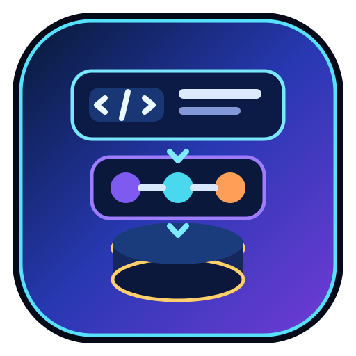

<p align="center">
  
</p>

# ReyadStack — Full Stack Architecture Guide in Arabic | دليل معمارية Full Stack للمطورين

[افتح الدليل / Live guide](https://reyad-dev.github.io/fullstack-architecture-guide/) · [GitHub](https://github.com/reyad-dev) · [Portfolio](https://reyad.site/)

**ReyadStack**, created by **Mohamed Reyad (@reyad-dev)**, is a free Arabic full-stack architecture guide for front-end developers who want to understand project architecture, backend structure, scaling, and production-ready organization.

## العربية

**ReyadStack** هو مرجع تعليمي مجاني باللغة العربية من تطوير **محمد رياض (@reyad-dev)** لمطوّر Front-end الذي يريد الانتقال إلى تطوير Full Stack وفهم اختيار المعمارية وتنظيم المشاريع والتوسع. الواجهة تركز على موضوع الدليل واحتياجات القارئ، مع توقيع صاحب المشروع في التذييل. الخط الأساسي وخط العناوين **Alexandria**، وخط الأكواد **IBM Plex Mono**.

### محتويات الدليل

- خطة تعلّم من 24 أسبوعًا، مقسمة إلى سبع مراحل بمخرجات ومعايير إتمام.
- الحزمة التقنية المقترحة، شرح المعماريات وجدول مقارنات.
- حاسبة تقديرية للحمل والتزامن، وسلّم التوسع.
- أداة لاختيار معمارية المشروع حسب نوعه وحجمه وفريقه وأولوياته.
- منهج لتنظيم المشاريع الكبيرة وملفات Markdown قابلة للنسخ.
- قواعد ذهبية، قائمة فحص تفاعلية وأخطاء Vibe Coding.

### تشغيل الملف

افتح `index.html` أو `fullstack-architecture-guide.html` في متصفح حديث. لا يحتاج المشروع إلى تثبيت حزم أو عملية بناء أو قاعدة بيانات. ويمكن تشغيله عبر خادم محلي اختياري:

```sh
python -m http.server 8000
```

ثم افتح <http://localhost:8000>. استخدم الفهرس للتنقل، وافتح المراحل التعليمية، وجرّب الحاسبة واختيار المعمارية، وانسخ القوالب من أزرار النسخ. يدعم الدليل الطباعة من المتصفح وتصميمًا متجاوبًا واتجاه RTL.

المحتوى التعليمي بالعربية؛ شرح الملف والتوثيق متاحان بالعربية والإنجليزية. خطوط Google Fonts تحتاج اتصالًا بالإنترنت مع وجود خطوط بديلة. قائمة الفحص لا تحفظ حالتها بعد إعادة تحميل الصفحة. أرقام التوسع ونتائج الاختيار إرشادية وتحتاج إلى قياسات فعلية واختبارات حمل قبل اتخاذ قرارات الإنتاج.

## English

**ReyadStack** is a free, public, interactive Arabic learning guide created by **Mohamed Reyad (@reyad-dev)** for front-end developers moving into full-stack development. It covers architecture selection, project organization and scaling. The interface puts the learning resource first, with a small creator credit in the footer. **Alexandria** is used for body text and headings; **IBM Plex Mono** is used for code.

### Features

- A 24-week roadmap with seven learning phases, deliverables and completion criteria.
- A suggested technology stack, architecture explanations and comparisons.
- An estimated load/concurrency calculator and scaling ladder.
- An architecture picker based on project type, audience, team and priorities.
- Large-project organization guidance and copyable Markdown templates.
- Development rules, an interactive launch checklist and Vibe Coding pitfalls.

### Run locally

Open `index.html` or `fullstack-architecture-guide.html` in a modern browser. No dependencies, build step or database are required. Optionally run `python -m http.server 8000` and visit <http://localhost:8000>.

Navigate through the section index, expand roadmap phases, adjust calculator inputs, try the architecture picker and copy templates. The guide supports responsive RTL layouts and browser printing.

The educational content remains Arabic; the file overview and documentation are bilingual. Google Fonts require internet access, with system fonts as fallbacks. Checklist state resets on page reload. Scaling estimates and recommendations are educational heuristics; validate production decisions with monitoring and load testing.

## Files | الملفات

| File | Purpose / الغرض |
| --- | --- |
| `index.html` | GitHub Pages entry point / الصفحة الرئيسية للنشر |
| `fullstack-architecture-guide.html` | Named standalone guide, identical to index / نسخة الدليل باسمها الأصلي |
| `assets/banner.svg` | Banner from the GitHub profile / بانر هوية البروفايل |
| `assets/favicon.svg` | MR browser icon / أيقونة المتصفح |
| `assets/repo-icon.svg` | Repository project icon / أيقونة المشروع |
| `.nojekyll` | Serve as a static site / نشر الملفات كموقع ثابت |
| `sitemap.xml` | Canonical page for search discovery / خريطة الصفحة الأساسية لمحركات البحث |

Both HTML files contain their CSS and JavaScript. Keep them identical when making updates.

ملفا HTML يحتويان CSS وJavaScript داخلهما. عند التعديل، حدّث الملفين ليظلا متطابقين.

## Publishing | النشر

GitHub Pages serves the root of the `main` branch. The repository includes `.nojekyll`, so no Jekyll build is needed.

ينشر GitHub Pages محتويات المجلد الرئيسي من فرع `main`، دون الحاجة إلى Jekyll.

## Search visibility | الظهور في البحث

The page includes a descriptive Arabic title and H1, a meta description, index/follow directives, a canonical URL, sharing metadata, LearningResource structured data, visible FAQs and a sitemap. Both HTML copies point to the same canonical URL to consolidate duplicate content. These settings support crawling and indexing; they do not guarantee search rankings or immediate indexing.

الصفحة مجهزة بعنوان ووصف عربيين، ورابط أساسي موحد، وبيانات منظمة للدليل التعليمي، وأسئلة شائعة وخريطة موقع. نسختا HTML تشيران إلى الرابط الأساسي نفسه. الإعدادات تساعد محركات البحث على فهم الصفحة، لكنها لا تضمن ترتيبًا أو فهرسة فورية.

To monitor indexing, verify ownership of the URL-prefix property `https://reyad-dev.github.io/fullstack-architecture-guide/` in Google Search Console. Add the provided verification tag to both HTML files, submit `sitemap.xml`, then inspect the canonical URL and request indexing. No Search Console property has been verified or indexing request submitted by this repository setup.

لمتابعة الفهرسة، أضف رابط المشروع كخاصية URL-prefix في Google Search Console، ثم ضع وسم التحقق الذي يمنحه Google داخل ملفي HTML. بعد التحقق، أرسل `sitemap.xml` وافحص الرابط الأساسي واطلب فهرسته. إعداد المشروع وحده لا ينشئ خاصية Search Console ولا يرسل طلب فهرسة.

References: [Google title guidance](https://developers.google.com/search/docs/appearance/title-link), [canonical URLs](https://developers.google.com/search/docs/crawling-indexing/consolidate-duplicate-urls), [sitemaps](https://developers.google.com/search/docs/crawling-indexing/sitemaps/build-sitemap).

## Mohamed Reyad | محمد رياض

[Website](https://reyad.site/) · [GitHub](https://github.com/reyad-dev) · [LinkedIn](https://www.linkedin.com/in/mohamed-reyad-marketing/) · [Behance](https://www.behance.net/mohamedmagdy336) · [Email](mailto:Info@reyad.site)
